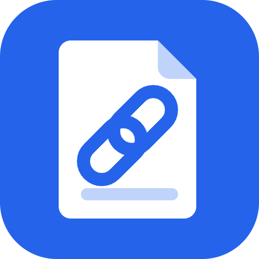
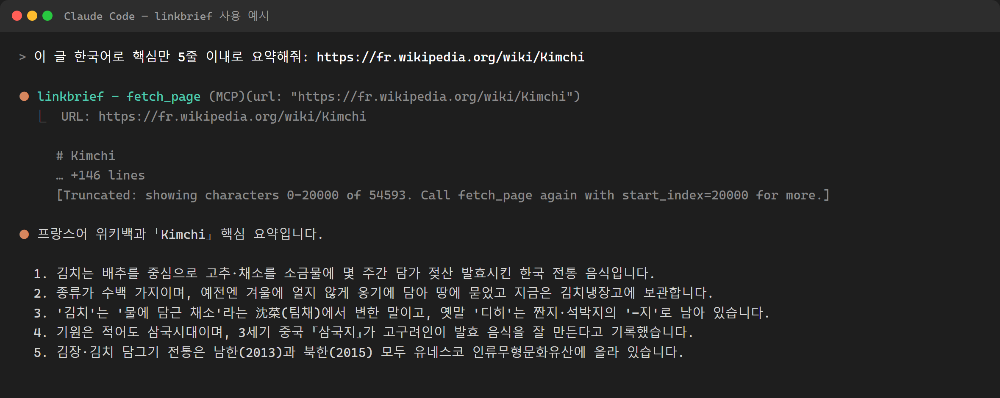
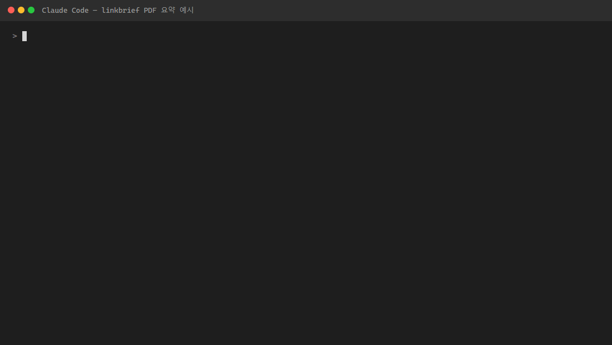
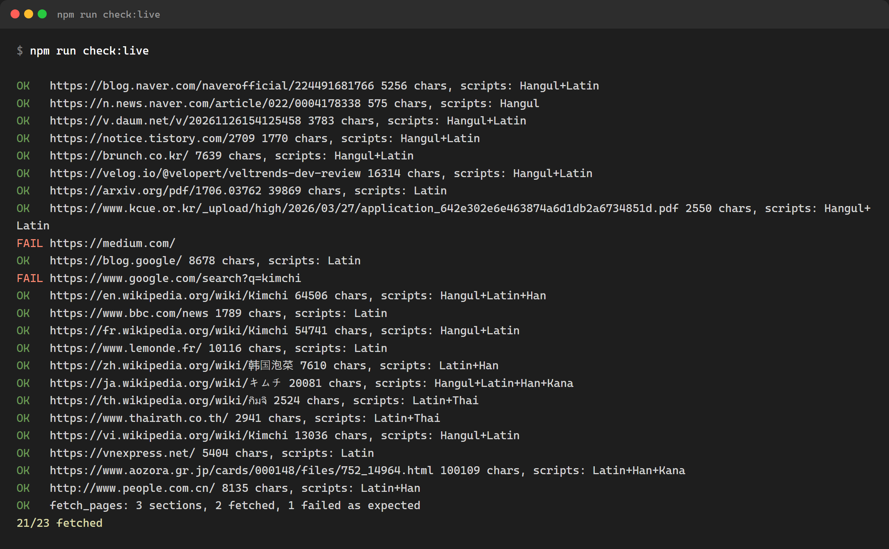

#  linkbrief-mcp

[English](README.md) | **한국어**

[](https://www.npmjs.com/package/linkbrief-mcp)
[](https://github.com/KDDYYY/linkbrief-mcp/actions/workflows/test.yml)
[](LICENSE)

**AI 에이전트에게 링크만 주세요. 필요한 내용만, 토큰은 약 95% 적게 읽습니다.**

linkbrief는 Claude, Codex, Cursor 등 MCP 에이전트용 서버입니다. 웹 페이지, PDF, Office 문서를 **내 PC에서 직접** 가져와 본문만 깔끔한 Markdown으로 넘깁니다. 제목·출처·작성자·작성일도 함께 붙습니다.



<sub>`fetch_page` 결과는 실제 linkbrief 출력이고, 요약은 Claude가 작성한 것입니다. (문서: 프랑스어 위키백과 「Kimchi」, CC BY-SA)</sub>

## 왜 linkbrief인가요?

- **토큰 약 95% 절감.** 메뉴·광고·스크립트·이미지 주소를 빼고 본문만 넘깁니다. 하나만 물으면 `find`가 관련 부분만 돌려줍니다.
- **다른 도구가 놓치는 것도 읽습니다.** 이미지로 올린 채용공고·포스터·공지(이미지를 에이전트에 그대로 넘기고, 긴 이미지는 읽기 좋게 잘라서), JavaScript 페이지, PDF, Word·PowerPoint·Excel·한글(.hwpx), Stack Overflow, GitHub 이슈·PR, 문서 사이트 통째로(`llms.txt` 지원), 네이버 블로그와 EUC-KR·Shift_JIS 같은 옛 인코딩까지.
- **내 PC에서 실행됩니다.** API 키·계정·비용이 없습니다. 회사 프록시 뒤에서도 동작합니다.
- **기본이 안전합니다.** 내부망은 막고, 봇 확인은 우회하지 않으며, 그 밖의 곳에는 접속하지 않습니다.

## 빠른 시작

[Node.js](https://nodejs.org) 22.12 이상이 필요합니다. Claude Code에서:

```bash
claude mcp add linkbrief -s user -- npx -y linkbrief-mcp
```

Windows(PowerShell)에서는 `cmd /c npx`를 쓰고 `--`를 따옴표로 감싸세요:

```powershell
claude mcp add linkbrief -s user '--' cmd /c npx -y linkbrief-mcp
```

Claude Code를 다시 열고 `/mcp`에서 `linkbrief`가 연결됐는지 확인한 뒤, 링크와 함께 부탁하면 끝입니다.

<details>
<summary><b>Claude Desktop, Codex, Cursor, 소스에서 설치</b></summary>

**Claude Desktop (클릭 한 번)** — [최신 릴리스](https://github.com/KDDYYY/linkbrief-mcp/releases/latest)에서 `linkbrief.mcpb`를 내려받아 더블클릭하세요.

**Claude Desktop (설정 파일)** — 설정 → 개발자 → 설정 편집:

```json
{ "mcpServers": { "linkbrief": { "command": "npx", "args": ["-y", "linkbrief-mcp"] } } }
```

**Codex** — `~/.codex/config.toml` (Windows는 `command = "cmd"`, `args = ["/c", "npx", "-y", "linkbrief-mcp"]`):

```toml
[mcp_servers.linkbrief]
command = "npx"
args = ["-y", "linkbrief-mcp"]
```

**Cursor 등 다른 MCP 클라이언트** — `npx -y linkbrief-mcp`를 stdio 서버로 등록하세요.

**소스에서 설치**

```bash
git clone https://github.com/KDDYYY/linkbrief-mcp.git && cd linkbrief-mcp && npm install
claude mcp add linkbrief -s user -- node "$(pwd)/server.mjs"
```

</details>

## 이렇게 부탁하세요

명령어를 외울 필요 없이, 평소처럼 말하고 링크만 붙이면 됩니다.

| 부탁 | linkbrief가 하는 일 |
|---|---|
| *3줄로 요약해 줘:* `https://blog.naver.com/…` | 본문만 가져옵니다 (어떤 언어든) |
| *이 문서에서 유산균 얘기만 정리해 줘:* `https://namu.wiki/w/김치` | `find`로 관련 부분만 돌려줍니다 |
| *핵심 기여 3가지만:* `https://arxiv.org/pdf/…` | PDF를 쪽별로 읽습니다 |
| *이 PR 요약하고 바뀐 파일 보여 줘:* `https://github.com/…/pull/123` | 본문, 댓글 전체, 변경 파일 |
| *채택된 답이 왜 되는지 설명해 줘:* `https://stackoverflow.com/questions/…` | 질문과 추천 답변 (공식 API) |
| *이 튜토리얼로 요약표 만들어 줘:* `https://docs.python.org/3/tutorial/` | 섹션 전체를 읽습니다 (`llms.txt`가 있으면 먼저) |
| *세 기사 논조 비교해 줘:* `<링크> <링크> <링크>` | 최대 10개를 한 번에 읽습니다 |

결과 맨 위에 사이트·작성자·작성일·주소가 붙어, 문단 단위(`…#s-2`)까지 출처를 달 수 있습니다.

## 측정된 절감 효과

실제 블로그·뉴스·위키 페이지에서 에이전트에게 넘어간 글자 수 기준 (2026년 11월):

| 방법 | 절감 |
|---|---:|
| 원본 HTML 대신 linkbrief로 페이지 전체 | **약 95%** (페이지별 92~99%) |
| `find` — 물어본 부분만 | 긴 문서에서 추가로 **76~88%** |
| `outline` 후 한 `section`만 | 긴 문서에서 추가로 **82~91%** |

토큰이 줄면 사용량 한도가 덜 차고, 답이 빨라지고, 긴 대화에서도 앞 내용을 덜 잊습니다.

## PDF와 문서 파일

PDF, `.docx`, `.pptx`, `.xlsx`, `.hwpx` 링크를 붙여 넣으세요. 다운로드 링크에서 오른쪽 클릭 → *링크 주소 복사*. 내 PC에 있는 파일은 에이전트에 직접 첨부하면 됩니다.



## 지원 현황

| | |
|---|---|
| ✅ 웹 페이지 | 모든 언어. JavaScript 페이지는 설치된 Chrome·Edge로. Shift_JIS, GBK, Big5, EUC-KR 등 |
| ✅ 개발자 사이트 | GitHub 이슈·PR·코드 파일 · Stack Overflow·Stack Exchange · Hacker News · arXiv · `llms.txt` 문서 사이트 |
| ✅ 문서 | PDF, Word, PowerPoint, Excel, 한글(.hwpx) |
| ✅ 이미지 속 글 | 이미지로 올린 채용공고·포스터·공지: 에이전트가 이미지를 직접 봅니다 (잡코리아 등 채용 사이트) |
| ✅ 국내 사이트 | 네이버 블로그, 네이버·다음 뉴스, 나무위키, 티스토리, 브런치, 벨로그 |
| ❌ 미지원 | 로그인·봇 확인이 필요한 페이지(Medium, Reddit), Google 검색 결과, YouTube 자막, 스캔 PDF |

## 기본이 안전합니다

- **내부망은 그대로 비공개.** `localhost`, 가정·사내망, 클라우드 메타데이터 주소는 거절하고 리다이렉트마다 다시 검사합니다. 악성 페이지가 에이전트를 속여 공유기나 사내망을 읽게 할 수 없습니다.
- **우회하지 않습니다.** 봇 확인은 알려 줄 뿐 풀지 않습니다. `fetch_site`는 robots.txt를 지키고 요청 사이에 쉽니다.
- **딴 곳에 접속하지 않습니다.** 사용자가 준 링크(와 GitHub·Stack Exchange 공개 API)에만 접속합니다. 원격 수집·키·계정이 없습니다.
- **격리된 브라우저.** JavaScript 재시도는 매번 빈 프로필로 열어 내 로그인·쿠키를 건드리지 않습니다.

<details>
<summary><b>도구 설명</b></summary>

**`fetch_page`** — 한 페이지·문서

| 인자 | 기본값 | |
|---|---|---|
| `url` | 필수 | 웹 페이지, PDF, Office 파일 |
| `find` | — | 이 단어나 `"따옴표 구절"`이 나오는 부분만 |
| `outline` | false | 제목 목차만 (문단 분량, 바로가기 포함) |
| `section` | — | 한 문단만: `"#3"` 또는 제목(`"역사"`, `"Page 4"`) |
| `max_length` / `start_index` | 20000 / 0 | 긴 글 나눠 읽기. 이어 읽는 방법은 결과에 안내됩니다 |
| `include_links` | false | 링크 주소 유지 (끄면 토큰 절약) |
| `render` | false | 처음부터 브라우저로 읽기 (보통 자동) |
| `images` | false | 본문 이미지도 함께 넘기기 (최대 8장). 글이 너무 적어 본문이 이미지인 페이지는 자동 |

**`fetch_pages`** — `urls` 최대 10개, `max_length_per_page`(8000), `include_links`.

**`fetch_site`** — `url`(시작 페이지, 같은 폴더 아래 링크만 따라감), `max_pages`(10, 최대 30), `max_length_per_page`(4000), `include_links`. 사이트에 `/llms.txt`가 있으면 먼저 읽고, robots.txt를 지키며, 45초가 지나면 읽은 만큼 돌려줍니다.

</details>

<details>
<summary><b>설정</b> (선택, 환경 변수)</summary>

| 변수 | 효과 |
|---|---|
| `HTTPS_PROXY`, `HTTP_PROXY`, `NO_PROXY` | 회사 프록시 (브라우저 재시도 포함) |
| `GITHUB_TOKEN` | GitHub API 한도 시간당 60회 → 5,000회 |
| `LINKBRIEF_ROBOTS=always` | 링크 하나를 읽을 때도 robots.txt 지키기 |
| `LINKBRIEF_BROWSER=off` / `=<경로>` | 브라우저 재시도 끄기, 또는 브라우저 지정 |

</details>

<details>
<summary><b>잘 안 될 때</b></summary>

| 메시지 | 해결 |
|---|---|
| 에이전트가 "링크를 열 수 없다"고 함 | 에이전트를 다시 시작하고 `/mcp`에서 `linkbrief` 연결 확인. "linkbrief로 읽어 줘"라고 말해도 됩니다 |
| `Page text too short` | 로그인이 필요하거나, JavaScript 페이지인데 Chrome·Edge가 없음 |
| `This site shows a bot check` | 사이트가 자동 읽기를 막습니다. 우회하지 않습니다 |
| `GitHub API: API rate limit exceeded` | `GITHUB_TOKEN`을 넣으세요 |
| `Refusing to fetch a private or local address` | 보안상 `localhost`·사내망은 막혀 있습니다 |
| `PDF has no extractable text` | 스캔 PDF입니다 (OCR 미지원) |
| `Old binary .hwp files are not supported` | .hwpx나 PDF로 저장하세요 |
| `npx` 오류 / `EBADENGINE` | `node --version`이 22.12 이상인지 확인 |

</details>

<details>
<summary><b>실제 사이트 38곳 점검 결과</b></summary>

`npm run check:live` (2026-11-27). Medium·Reddit·Google 검색은 의도적으로 거절합니다.



</details>

<details>
<summary><b>개발·기여</b></summary>

```bash
npm install
npm test                    # 단위·로컬 서버·프록시·무작위 입력 테스트 (오프라인)
npm run check:live          # 실제 사이트
node page.mjs <URL>         # 한 페이지의 추출 결과 보기
```

코드: `tools.mjs`(MCP 도구), `page.mjs`(가져오기·보안·추출·PDF), `sites.mjs`(사이트별 규칙), `office.mjs`, `browser.mjs`, `robots.mjs`.

새 사이트는 `sites.mjs`에 규칙(`rewrite`, `pick`, `load`, `refuse`)을 추가하고 `test.mjs`에 테스트를 넣어 주세요. `fixtures/`의 테스트 HTML은 실제 글을 복사하지 말고 직접 작성해 주세요.

"이 사이트가 안 돼요" 이슈를 주소와 함께 올려 주시면 특히 반갑습니다.

</details>

## 라이선스

MIT
