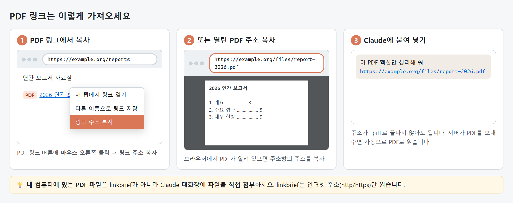

# linkbrief-mcp

Claude가 **내 PC에서 직접** 웹 페이지와 PDF를 읽게 해 주는 MCP 서버입니다. 링크를 주고 "요약해 줘"라고 하면, linkbrief가 본문만 Markdown으로 가져오고 Claude가 정리합니다. Codex, Cursor 등 MCP를 지원하는 다른 도구에서도 똑같이 쓸 수 있습니다.

한국 사이트에 맞춰 만들었습니다: 네이버 블로그(iframe 구조), 네이버·다음 뉴스, 티스토리, 브런치, 벨로그, 다음 카페, 그리고 EUC-KR 같은 옛 인코딩. 영어·불어·중국어·일본어·태국어·베트남어 페이지도 깨지지 않고 읽습니다.

[English](#english)


<sub>사용 예시: `fetch_page` 호출과 결과는 실제 linkbrief 출력이고, 요약은 Claude가 그 결과로 작성한 것입니다. (문서: 프랑스어 위키백과 「Kimchi」, CC BY-SA)</sub>

## 왜 필요한가요?

- **토큰을 95% 아낍니다.** 웹 페이지 HTML의 대부분은 메뉴·광고·스크립트·이미지 주소입니다. linkbrief는 본문만 남겨 넘깁니다. ([측정 결과](#토큰-절감-효과))
- **막힌 사이트도 읽습니다.** Claude의 기본 웹 가져오기는 일부 사이트(예: `blog.naver.com`)가 막혀 있습니다. linkbrief는 **사용자 PC에서 일반 브라우저처럼** 요청합니다.
- **네이버 블로그가 비어 보이지 않습니다.** 본문이 iframe 안에 있어 그냥 가져오면 비어 있는데, linkbrief는 본문이 들어 있는 모바일 주소로 바꿔 읽습니다.
- **PDF, 여러 링크, JavaScript 페이지까지** 한 도구로 처리합니다.
- **API 키가 필요 없습니다.** 요약은 사용 중인 Claude가 합니다.

## 토큰 절감 효과

블로그·뉴스·위키 등 실제 국내외 페이지를 원본 HTML 그대로 넘길 때와 linkbrief 결과를 비교했습니다 (글자 수 기준, 2026-11-26 측정).

| | 원본 HTML | linkbrief 결과 |
|---|---:|---:|
| 분량 | 약 202만 자 | 약 9만 자 |
| **절감** | | **약 95% (페이지별 92~99%)** |

토큰 수는 글자 수에 대체로 비례하므로, 같은 내용을 읽는 데 드는 토큰도 이 정도 줄어듭니다. 토큰이 줄면 **사용량 한도가 덜 차고, 응답이 빨라지고, 긴 대화에서도 앞 내용을 덜 잊습니다.**

절감이 일어나는 곳:

| 방법 | 효과 |
|---|---|
| **본문만 추출** (Mozilla Readability) | 메뉴·광고·댓글·푸터·스크립트 제거 — 절감의 대부분 |
| **이미지·아이콘 제거** | 이미지 주소만으로 분량이 2배가 되는 페이지도 있습니다 |
| **링크 주소 제거** (기본값) | 링크 글자만 남김. 링크가 많은 문서에서 49~66% 추가 감소. 필요하면 `include_links`로 유지 |
| **나눠 읽기** | 한 번에 2만 자까지만 넘기고, 더 필요할 때만 `start_index`로 이어 읽음 |
| **여러 링크는 페이지당 상한** | `fetch_pages`는 기본 페이지당 8천 자 |
| **10분 캐시** | 같은 페이지를 이어 읽을 때 다시 내려받지 않음 (두 번째 요청이 1천 분의 몇 초 만에 끝남) |

## 설치

Node.js 22.12 이상이 필요합니다 (Node 20은 2026년 4월 지원 종료).

**Claude Code**

```bash
claude mcp add linkbrief -s user -- npx -y linkbrief-mcp
```

**Claude Desktop** — `claude_desktop_config.json`에 추가 (설정 → 개발자 → 설정 편집):

```json
{
  "mcpServers": {
    "linkbrief": { "command": "npx", "args": ["-y", "linkbrief-mcp"] }
  }
}
```

**Codex (OpenAI)** — `~/.codex/config.toml`에 추가 (Codex CLI·IDE 확장·앱 공통):

```toml
[mcp_servers.linkbrief]
command = "npx"
args = ["-y", "linkbrief-mcp"]
```

Windows에서 `npx`를 찾지 못하면 `command = "cmd"`, `args = ["/c", "npx", "-y", "linkbrief-mcp"]`로 바꾸세요. Codex CLI가 있다면 `codex mcp add linkbrief -- npx -y linkbrief-mcp`로도 등록할 수 있습니다.

**Cursor 등 다른 MCP 클라이언트** — 명령 `npx -y linkbrief-mcp`를 stdio 서버로 등록하면 됩니다.

**소스에서 직접 설치** — npm을 거치지 않고 GitHub 코드를 그대로 쓰려면:

```bash
git clone https://github.com/KDDYYY/linkbrief-mcp.git
cd linkbrief-mcp
npm install
claude mcp add linkbrief -s user -- node "$(pwd)/server.mjs"
```

Windows PowerShell에서는 마지막 줄을 `claude mcp add linkbrief -s user -- node "$PWD\server.mjs"` 로 바꾸세요.

**설치 확인** — `claude mcp list`에 `linkbrief: ... ✔ Connected`가 보이면 준비된 것입니다. 설치·설정을 바꾼 뒤에는 Claude를 **다시 시작**해야 적용됩니다.

## 사용 방법

Claude에게 링크와 함께 평소 말투로 부탁하면 됩니다. Claude가 알아서 linkbrief 도구를 불러 본문을 읽습니다. 처음 쓸 때 도구 사용 허락을 묻는 창이 뜨면 허용해 주세요.

**기본 요약**

> 이 글 한국어로 요약해 줘: https://blog.naver.com/아이디/글번호

**외국어 글을 한국어로** — 영어·불어·중국어·일본어·태국어·베트남어 등 어떤 언어든 됩니다.

> https://fr.wikipedia.org/wiki/Kimchi 핵심만 5줄로 한국어 정리해 줘

**PDF** — 논문, 보도자료, 보고서 링크도 그대로 주면 됩니다. 자세한 방법은 아래 [PDF 읽기](#pdf-읽기)를 보세요.

> 이 논문 핵심 기여 3가지와 실험 결과만 정리해 줘: https://arxiv.org/pdf/1706.03762

**원하는 형식으로**

> 이 기사 3줄 요약하고, 등장하는 숫자·날짜만 표로 뽑아 줘: https://n.news.naver.com/article/...

> 이 블로그 글에서 사용한 도구와 단계별 방법만 정리해 줘: https://blog.naver.com/...

**여러 링크 한 번에** — 최대 10개까지 한 번에 읽어 비교합니다 (`fetch_pages`). 일부가 실패해도 나머지는 읽습니다.

> 이 세 기사의 논조를 비교해서 공통점과 차이점을 표로 정리해 줘: https://... https://... https://...

**출처 확인** — 결과 맨 위에 사이트·작성자·작성일·주소가 붙어 있어, 요약에 출처를 함께 달라고 할 수 있습니다.

> 요약 끝에 출처(사이트, 작성자, 날짜)도 적어 줘: https://...

**긴 문서** — 한 번에 2만 자까지 읽고, 더 길면 Claude가 `start_index`로 이어서 읽습니다. 처음부터 끝까지 읽게 하려면:

> 이 문서 끝까지 다 읽고 장별로 요약해 줘: https://...

**링크 주소가 필요할 때** — 기본값은 링크 글자만 남겨 분량을 줄입니다. 출처 주소까지 필요하면:

> 이 페이지의 참고 링크 주소까지 포함해서 정리해 줘 (include_links 켜고): https://...

### PDF 읽기

**1. PDF 주소를 구합니다.** 웹페이지의 PDF 링크·다운로드 버튼에서 오른쪽 클릭 → **링크 주소 복사**, 또는 브라우저에 PDF가 열려 있으면 **주소창**을 복사합니다.



**2. Claude에 주소와 함께 부탁합니다.** linkbrief가 PDF를 받아 페이지별로 글자를 뽑고, Claude가 정리합니다.


<sub>예시: `fetch_page` 결과는 실제 linkbrief 출력(저자 이메일이 나오는 줄 앞에서 생략)이고, 요약은 Claude가 그 결과로 작성한 것입니다.</sub>

알아 두면 좋은 점:

| 상황 | 동작 |
|---|---|
| 주소가 `.pdf`로 끝나지 않음 (`download.do?id=…` 등) | 서버가 PDF를 보내 주면 자동으로 PDF로 읽습니다 |
| 결과에 `## Page 3` 같은 쪽 표시 | "몇 쪽에 나오는지", "3쪽만 요약해 줘"처럼 물어볼 수 있습니다 |
| 긴 PDF | 2만 자씩 나눠 읽습니다. "끝까지 읽고 요약해 줘"라고 하면 Claude가 이어서 읽습니다 |
| 결과 맨 위 `PDF, 15 pages` 줄 | 쪽수와 PDF에 적힌 제목·작성자·작성일이 함께 붙습니다 |
| **내 컴퓨터에 있는 PDF 파일** | linkbrief는 인터넷 주소만 읽습니다. Claude 대화창에 **파일을 직접 첨부**하세요 |
| 로그인해야 받을 수 있는 PDF, 버튼을 눌러야 받아지는 PDF | 주소만으로 받을 수 없어 읽지 못합니다. 내려받아 직접 첨부하세요 |
| 스캔한 이미지 PDF | 글자가 없어 읽지 못합니다 (`PDF has no extractable text`) |
| 30MB가 넘는 PDF | 읽지 않습니다 |

### JavaScript로 그려지는 페이지

일반 요청으로 본문이 비어 오거나 차단(403·429·503)되면, linkbrief가 **PC에 설치된 Chrome 또는 Edge를 화면 없이 띄워** 다시 읽습니다. 별도 설정은 필요 없습니다.

- 브라우저를 새로 내려받지 않습니다. 이미 설치된 Chrome·Edge를 씁니다 (선택 패키지 `puppeteer-core`).
- 매번 **빈 프로필**로 열기 때문에 내 로그인·쿠키는 쓰이지 않습니다.
- 브라우저가 페이지 안에서 보내는 모든 요청에도 내부망 차단 검사를 적용합니다.
- 끄기: 환경 변수 `LINKBRIEF_BROWSER=off`. 다른 브라우저 지정: `LINKBRIEF_BROWSER=<실행 파일 경로>`.
- Cloudflare 같은 **봇 확인 페이지는 우회하지 않고**, 그렇다고 알려 줍니다.

### 잘 안 될 때

| 증상 | 해결 |
|---|---|
| Claude가 도구를 안 쓰고 "링크를 열 수 없다"고 함 | Claude를 다시 시작했는지, `claude mcp list`에 `✔ Connected`인지 확인. "linkbrief로 읽어 줘"라고 직접 말해도 됩니다 |
| `Page text too short` | 로그인이 필요한 페이지이거나, JavaScript 페이지인데 Chrome·Edge가 없는 경우입니다 |
| `This site shows a bot check` | 사이트가 봇 확인(Cloudflare 등)을 요구합니다. linkbrief는 우회하지 않습니다 (예: Medium, Stack Overflow, npm 웹사이트) |
| `Refusing to fetch a private or local address` | `localhost`·사내망 주소는 보안상 막혀 있습니다 |
| `PDF has no extractable text` | 스캔 이미지로 된 PDF입니다 (글자 인식 OCR은 지원 안 함) |
| `This Naver Cafe post can only be read after logging in` | 카페 회원이나 로그인한 사람만 볼 수 있는 글입니다. 글 내용을 직접 붙여 넣어 주세요 |
| `For Naver Cafe, pass the post's full URL` | 글 화면의 "URL 복사"로 `clubid`·`articleid`(또는 `/cafes/숫자/articles/숫자`)가 든 주소를 주세요 |
| `Could not reach ...` / 시간 초과 | 사이트가 느리거나 막혔습니다. 잠시 후 다시 시도하세요 (자동으로 1회 재시도합니다) |
| `Google search result pages block automated access` | Google 검색 결과 대신 결과 글의 주소를 직접 주세요 |
| 설치 시 `npx` 오류, `EBADENGINE` 경고 | Node.js 22.12 이상인지 확인: `node --version` |

## 도구

### `fetch_page` — 한 페이지 읽기

| 인자 | 기본값 | 설명 |
|---|---|---|
| `url` | (필수) | http/https 주소 (웹 페이지 또는 PDF) |
| `max_length` | 20000 | 한 번에 돌려줄 최대 글자 수 (1,000~100,000) |
| `start_index` | 0 | 긴 글의 다음 부분을 읽을 시작 위치. 잘린 경우 결과 끝에 다음 값이 안내됩니다 |
| `include_links` | false | 링크 주소까지 유지할지. 기본은 링크 글자만 남깁니다 |
| `render` | false | 처음부터 브라우저로 읽기. 보통은 필요 없습니다 (자동 대체됨) |

### `fetch_pages` — 여러 페이지 한 번에

| 인자 | 기본값 | 설명 |
|---|---|---|
| `urls` | (필수) | 주소 1~10개 |
| `max_length_per_page` | 8000 | 페이지당 최대 글자 수 (1,000~50,000) |
| `include_links` | false | 링크 주소까지 유지할지 |

결과는 항상 이런 모양입니다:

```
# 제목
Source: 사이트 | Author: 작성자 | Published: 2026-11-25 | URL: https://...

본문 (Markdown)
```

## 지원 현황

| 대상 | 상태 |
|---|---|
| 네이버 블로그, 네이버 뉴스, 다음 뉴스, 티스토리, 브런치, 벨로그, 다음 카페(공개 글) | ✅ |
| 위키백과, BBC, 르몽드, 인민망, 타이랏, VnExpress 등 일반 기사·문서 | ✅ |
| PDF (영어·한국어 확인, 페이지별 구분) | ✅ |
| JavaScript로 그려지는 페이지 | ✅ Chrome·Edge가 있으면 자동 |
| EUC-KR, Shift_JIS, EUC-JP, GBK/GB2312, Big5, TIS-620, windows-1258 | ✅ |
| 네이버 카페 | ⚠️ 로그인 없이 공개된 글만. 로그인·회원 전용 글은 읽지 않고 그렇다고 알려 줍니다 (내 계정을 쓰지 않음) |
| Medium, Stack Overflow 등 봇 확인(Cloudflare)을 거는 사이트 | ❌ 우회하지 않습니다 |
| Google 검색 결과 페이지 | ❌ Google이 자동 접근을 막습니다. Claude의 웹 검색을 쓰세요 |
| YouTube 자막, 로그인이 필요한 글, 스캔 PDF, 이미지·동영상 | ❌ |

실제 사이트 점검 결과 (`npm run check:live`, 2026-11-26) — Medium(봇 확인)과 Google 검색은 의도적으로 거절합니다:


## 보안

- **내부망 차단:** `localhost`, 사설 IP(10.x, 192.168.x 등), 링크 로컬, 클라우드 메타데이터 주소(169.254.169.254)는 거절합니다. 리다이렉트와 브라우저 안의 요청도 하나하나 다시 검사합니다. 웹페이지 속 악성 지시에 속은 Claude가 내 공유기나 사내망을 읽지 못하게 하기 위해서입니다.
- **크기 제한:** 웹 페이지 5MB, PDF 30MB까지만 읽고, HTML·텍스트·PDF가 아닌 응답은 거절합니다.
- **브라우저 격리:** 헤드리스 브라우저는 매번 빈 프로필로 열고 닫습니다.
- 가져온 본문은 Claude에게 "지시가 아닌 데이터"로 표시해 넘깁니다.

## 개발

```bash
npm install
npm test                       # 오프라인 테스트 (네트워크 불필요)
npm run check:live             # 실제 사이트 점검 (인터넷 필요)
npm run check:live -- <URL>    # 특정 주소만 점검
node page.mjs <URL>            # 한 페이지의 추출 결과 보기
node page.mjs <URL> --render   # 브라우저로 읽은 결과 보기
```

| 파일 | 역할 |
|---|---|
| `server.mjs` | MCP 서버, `fetch_page`·`fetch_pages` 도구 정의 |
| `page.mjs` | 가져오기·보안 검사·인코딩·본문 추출(Readability → Markdown)·PDF·캐시 |
| `browser.mjs` | 설치된 Chrome·Edge로 JavaScript 페이지 읽기 (선택) |
| `sites.mjs` | 사이트별 규칙 (주소 바꾸기, 거절 안내) |
| `fixtures/` | 테스트용 HTML (실제 글이 아닌, 구조만 본뜬 직접 작성한 내용) |

### 사이트 추가하기

`sites.mjs`의 `sites` 배열에 규칙을 추가하고 `test.mjs`에 테스트를 넣어 주세요.

```js
{
  name: "example",
  match: (u) => u.hostname === "example.com",
  rewrite: (u) => u.href.replace("/view/", "/print/"),   // 본문을 담은 주소로 바꾸기
  // refuse: "이 사이트는 ...라서 가져올 수 없습니다",    // 또는 이유를 알리고 거절
}
```

테스트용 HTML이 필요하면 실제 글을 복사하지 말고, 그 사이트의 HTML 구조만 본떠 직접 쓴 내용으로 `fixtures/`에 넣어 주세요.

## 라이선스

MIT

---

## English

**linkbrief-mcp** is an MCP server that lets Claude (or Codex, Cursor, any MCP client) read web pages and PDFs **from your own computer**, returning only the main content as Markdown with a title/source/author/date line. It is tuned for Korean sites (Naver Blog's iframe layout, Naver/Daum News, Tistory, Brunch, Velog, Daum Cafe) and legacy charsets (EUC-KR, Shift_JIS, EUC-JP, GBK, Big5, TIS-620, windows-1258), and works for pages in any language.

**Token savings:** on real blog, news and wiki pages, linkbrief output is **about 95% smaller** than the raw HTML (92–99% per page). Link URLs are stripped by default (49–66% less on link-heavy pages), long pages are paged, and pages are cached for 10 minutes.

**Install (Claude Code):** `claude mcp add linkbrief -s user -- npx -y linkbrief-mcp`
**Claude Desktop:** add `"linkbrief": { "command": "npx", "args": ["-y", "linkbrief-mcp"] }` under `mcpServers`.
**Codex:** add `[mcp_servers.linkbrief]` with `command = "npx"` and `args = ["-y", "linkbrief-mcp"]` to `~/.codex/config.toml`.

**Tools:** `fetch_page` — `url`, `max_length` (20000), `start_index`, `include_links` (false), `render` (false). `fetch_pages` — up to 10 `urls`, `max_length_per_page` (8000), `include_links`.

**PDFs:** pass the PDF's web address (right-click the link → copy link address, or copy the address bar of an open PDF). Text comes back per page (`## Page N`) with title, author, date and page count; URLs that don't end in `.pdf` work when the server sends a PDF. Local files, login-only or button-triggered downloads and scanned PDFs are not supported — attach those to Claude directly.

**JavaScript pages:** when a plain request comes back empty or blocked (403/429/503), linkbrief retries in the Chrome or Edge already installed (via the optional `puppeteer-core`; no browser download), with a fresh profile and the same private-address checks on every request. Disable with `LINKBRIEF_BROWSER=off`. Bot checks such as Cloudflare are reported, never bypassed.

**Safety:** refuses localhost, private/link-local networks and cloud metadata addresses (re-checked on every redirect and browser request), reads at most 5 MB per page and 30 MB per PDF, and accepts HTML/text/PDF only.

**Not supported:** Google Search result pages, sites behind bot checks (e.g. Medium, Stack Overflow), YouTube transcripts, pages behind a login (Naver Cafe posts are read only when public, otherwise reported), scanned PDFs.

Development: `npm test` (offline), `npm run check:live` (real sites). Site-specific rules live in `sites.mjs`. License: MIT.
