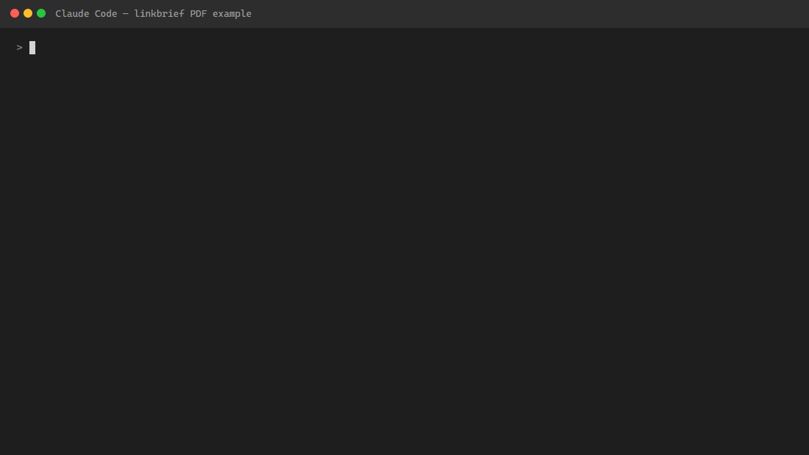

# linkbrief-mcp

**English** | [한국어](README.ko.md)

[](https://www.npmjs.com/package/linkbrief-mcp)
[](https://github.com/KDDYYY/linkbrief-mcp/actions/workflows/test.yml)
[](LICENSE)

**Give your AI agent any link. It reads only what matters — with ~95% fewer tokens.**

linkbrief is an MCP server for Claude, Codex, Cursor and other agents. It fetches web pages, PDFs and Office files from your own computer and hands the agent clean Markdown: just the article, with title, source, author and date.


<sub>Real linkbrief output; the summary is Claude's. Source: French Wikipedia, "Kimchi" (CC BY-SA).</sub>

## Why linkbrief

- **~95% fewer tokens.** Menus, ads, scripts and image URLs are dropped. Ask about one thing and `find` returns only the passages that mention it.
- **Reads what others miss.** JavaScript pages, PDFs, Word/PowerPoint/Excel, Stack Overflow, GitHub issues and PRs, whole docs sites (it follows `llms.txt`), and Asian sites in legacy encodings.
- **Runs on your machine.** No API key, no account, no cost. Works behind corporate proxies.
- **Safe by default.** Private networks are blocked, bot checks are never bypassed, and nothing else is ever contacted.

## Quick start

Needs [Node.js](https://nodejs.org) 22.12+. For Claude Code:

```bash
claude mcp add linkbrief -s user -- npx -y linkbrief-mcp
```

On Windows, use `cmd /c npx` instead of `npx`:

```powershell
claude mcp add linkbrief -s user -- cmd /c npx -y linkbrief-mcp
```

Reopen Claude Code, type `/mcp` to see `linkbrief` connected, then paste a link and ask. That's it.

<details>
<summary><b>Claude Desktop, Codex, Cursor, from source</b></summary>

**Claude Desktop (one click)** — download `linkbrief.mcpb` from the [latest release](https://github.com/KDDYYY/linkbrief-mcp/releases/latest) and double-click it.

**Claude Desktop (config)** — Settings → Developer → Edit Config:

```json
{ "mcpServers": { "linkbrief": { "command": "npx", "args": ["-y", "linkbrief-mcp"] } } }
```

**Codex** — `~/.codex/config.toml` (on Windows use `command = "cmd"`, `args = ["/c", "npx", "-y", "linkbrief-mcp"]`):

```toml
[mcp_servers.linkbrief]
command = "npx"
args = ["-y", "linkbrief-mcp"]
```

**Cursor and other MCP clients** — add `npx -y linkbrief-mcp` as a stdio server.

**From source**

```bash
git clone https://github.com/KDDYYY/linkbrief-mcp.git && cd linkbrief-mcp && npm install
claude mcp add linkbrief -s user -- node "$(pwd)/server.mjs"
```

</details>

## What you can ask

No commands to learn — talk to your agent as usual and include the link.

| You ask | linkbrief does |
|---|---|
| *Summarize this in 5 bullets:* `https://en.wikipedia.org/wiki/…` | Returns only the article, any language |
| *What does it say about hallucination?* `<long page>` | `find` returns just the matching passages |
| *List the paper's contributions:* `https://arxiv.org/pdf/…` | Reads the PDF page by page |
| *Summarize this PR and its changed files:* `https://github.com/…/pull/123` | Description, every comment, changed files |
| *Why does the accepted answer work?* `https://stackoverflow.com/questions/…` | Question and top answers, via the official API |
| *Make a cheat sheet from these docs:* `https://docs.python.org/3/tutorial/` | Reads the section, `llms.txt` first if the site has one |
| *Compare these three articles:* `<link> <link> <link>` | Reads up to 10 links at once |

Every result starts with site, author, date and URL, so your agent can cite its sources — down to the section (`…#History`).

## Measured savings

Characters sent to the agent, on real blog, news and wiki pages (November 2026):

| Approach | Saved |
|---|---:|
| Whole page through linkbrief, vs. raw HTML | **~95%** (92–99% per page) |
| `find` — only the passages you ask about | a further **76–88%** on long documents |
| `outline`, then one `section` | a further **82–91%** on long documents |

Fewer tokens mean your usage limits last longer, answers come faster, and long chats keep more context.

## PDFs and documents

Paste the link to a PDF, `.docx`, `.pptx`, `.xlsx` or `.hwpx` — right-click a download link → *Copy link address*. For files on your computer, attach them to your agent directly.



## Works with

| | |
|---|---|
| ✅ Web pages | Any language; JavaScript pages via your installed Chrome/Edge; Shift_JIS, GBK, Big5, EUC-KR and more |
| ✅ Developer sites | GitHub issues, PRs and code files · Stack Overflow & Stack Exchange · Hacker News · arXiv · docs sites with `llms.txt` |
| ✅ Documents | PDF, Word, PowerPoint, Excel, Hangul (.hwpx) |
| ✅ Korean sites | Naver Blog, Naver/Daum News, Namuwiki, Tistory, Brunch, Velog |
| ❌ Not supported | Pages behind a login or a bot check (Medium, Reddit), Google Search result pages, YouTube transcripts, scanned PDFs |

## Safe by default

- **Your network stays private.** `localhost`, home/office networks and cloud metadata addresses are refused — checked again on every redirect — so a malicious page can't make your agent read your router or intranet.
- **No bypassing.** Bot checks are reported, not solved. `fetch_site` honours robots.txt and pauses between requests.
- **Nothing extra.** linkbrief only contacts the links you give it (and GitHub's or Stack Exchange's public API for those sites). No telemetry, no keys, no accounts.
- **Isolated browser.** The JavaScript fallback uses a fresh profile every time — your logins and cookies are never touched.

<details>
<summary><b>Tools reference</b></summary>

**`fetch_page`** — one page or document

| Argument | Default | |
|---|---|---|
| `url` | required | Web page, PDF or Office file |
| `find` | — | Only passages mentioning these words or `"quoted phrases"` |
| `outline` | false | Only the headings, with section sizes and anchors |
| `section` | — | One section: `"#3"` or heading text (`"History"`, `"Page 4"`) |
| `max_length` / `start_index` | 20000 / 0 | Paging for long text; the reply says how to continue |
| `include_links` | false | Keep link URLs (off saves tokens) |
| `render` | false | Use the browser first (normally automatic) |

**`fetch_pages`** — up to 10 `urls`, `max_length_per_page` (8000), `include_links`.

**`fetch_site`** — `url` (start page; only links under its folder are followed), `max_pages` (10, up to 30), `max_length_per_page` (4000), `include_links`. Reads `/llms.txt` first when the site has one, honours robots.txt, and stops after 45 seconds with what it has.

</details>

<details>
<summary><b>Settings</b> (optional environment variables)</summary>

| Variable | Effect |
|---|---|
| `HTTPS_PROXY`, `HTTP_PROXY`, `NO_PROXY` | Corporate proxy, also for the browser fallback |
| `GITHUB_TOKEN` | GitHub API limit from 60 to 5,000 requests/hour |
| `LINKBRIEF_ROBOTS=always` | Honour robots.txt for single links too |
| `LINKBRIEF_BROWSER=off` or `=<path>` | Disable the browser fallback, or pick a browser |

</details>

<details>
<summary><b>Troubleshooting</b></summary>

| Message | What to do |
|---|---|
| Agent says it can't open links | Restart the agent; `/mcp` should show `linkbrief` connected. Or say "read it with linkbrief" |
| `Page text too short` | The page needs a login, or it needs JavaScript and no Chrome/Edge was found |
| `This site shows a bot check` | The site blocks automated reading; linkbrief won't bypass it |
| `GitHub API: API rate limit exceeded` | Set `GITHUB_TOKEN` |
| `Refusing to fetch a private or local address` | Blocked for safety: `localhost` and private networks |
| `PDF has no extractable text` | Scanned PDF; OCR isn't supported |
| `Old binary .hwp files are not supported` | Save as .hwpx or PDF |
| `npx` errors / `EBADENGINE` | Check `node --version` is 22.12 or later |

</details>

<details>
<summary><b>Live check against 38 real sites</b></summary>

`npm run check:live` (2026-11-27). Medium, Reddit and Google Search are refused on purpose.


</details>

<details>
<summary><b>Development and contributing</b></summary>

```bash
npm install
npm test                    # unit, local-server, proxy and fuzz tests (offline)
npm run check:live          # real sites
node page.mjs <URL>         # see what linkbrief extracts from one page
```

Code: `tools.mjs` (MCP tools), `page.mjs` (fetching, safety, extraction, PDFs), `sites.mjs` (per-site rules), `office.mjs`, `browser.mjs`, `robots.mjs`.

To support a new site, add a rule to `sites.mjs` (`rewrite`, `pick`, `load` or `refuse`) with a test in `test.mjs`. Test HTML in `fixtures/` must be written by you, not copied from a real article.

"This site doesn't work" issues with the URL are especially welcome.

</details>

## License

MIT
