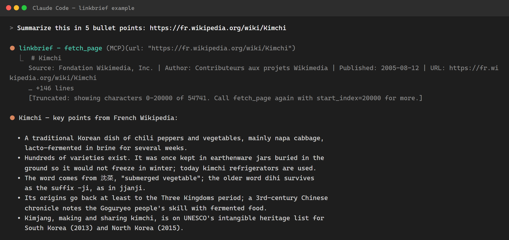
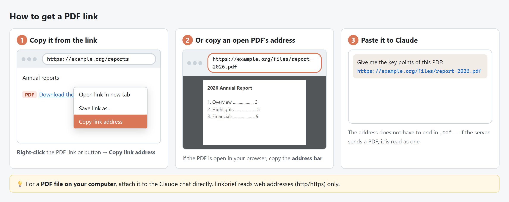
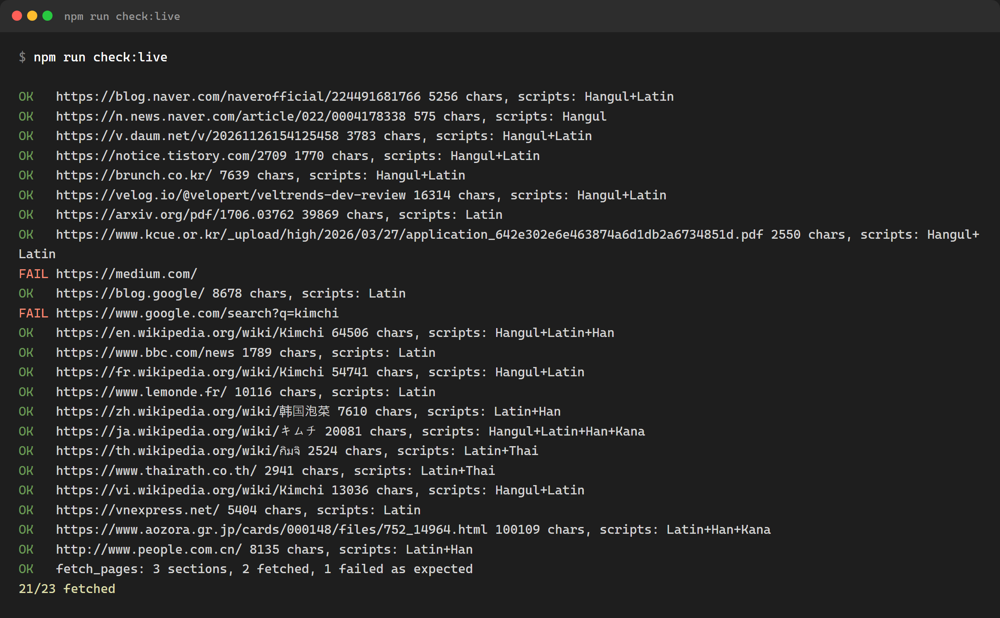

# linkbrief-mcp

**English** | [한국어](README.ko.md)

[](https://www.npmjs.com/package/linkbrief-mcp)
[](https://github.com/KDDYYY/linkbrief-mcp/actions/workflows/test.yml)
[](LICENSE)

Let Claude, Codex or any MCP agent **read any link** — web pages, PDFs, Office files and JavaScript-heavy pages — as clean Markdown, fetched **from your own computer**. About **95% fewer tokens** than raw HTML.

Give your agent a link and ask; linkbrief brings back just the main content with its title, source, author and date, and the agent does the rest. Works in any language, including sites most fetchers get wrong: Asian sites, Naver Blog's iframe layout, Namuwiki, and legacy encodings like Shift_JIS, GBK and EUC-KR.



<sub>Example: the `fetch_page` call and its result are real linkbrief output; the summary was written by Claude from that result. (Source: French Wikipedia, "Kimchi", CC BY-SA.)</sub>

## Why linkbrief

- **~95% fewer tokens.** Most of a page's HTML is menus, ads, scripts and image URLs. linkbrief keeps the article. ([measured](#token-savings))
- **Read only the part you need.** Ask for an outline first — headings, sizes and a one-line preview — then read just the section that matters. On a long Wikipedia article that is 87% less than reading it all.
- **Built for developers.** GitHub issues and PRs come with every comment and the changed files; Stack Overflow questions with their top answers; Hacker News threads in full; arXiv abstracts open the paper. Point it at a docs site and it reads the section for you (`fetch_site`).
- **Documents, not just pages.** PDFs page by page, and Word, PowerPoint, Excel and Hangul (.hwpx) files from a link.
- **Reads what other fetchers miss.** Pages that render with JavaScript are retried in the Chrome or Edge you already have. PDFs come back as text, page by page. Requests come from your machine, so sites that block cloud fetchers still answer.
- **Any language, any encoding.** Tested on Wikipedia in six languages, plus news and docs sites in English, French, German, Japanese, Chinese, Thai and Vietnamese. Legacy charsets (Shift_JIS, EUC-JP, GBK, Big5, EUC-KR, TIS-620, windows-1258) decode correctly.
- **Safe by default.** Private and local network addresses are refused, bot checks are reported rather than bypassed, and the browser runs with a fresh profile every time.
- **No API key.** The agent you already use does the summarizing.

## Quick start (Claude Code)

**1. Install** — one line. `npx` fetches the package from npm, so there is nothing else to install.

```bash
claude mcp add linkbrief -s user -- npx -y linkbrief-mcp
```

On Windows (PowerShell or Command Prompt), wrap `npx` in `cmd /c` for a reliable connection:

```powershell
claude mcp add linkbrief -s user -- cmd /c npx -y linkbrief-mcp
```

**2. Check the connection** — reopen Claude Code and type `/mcp`. You should see `linkbrief` connected with two tools, `fetch_page` and `fetch_pages`. (From a terminal: `claude mcp list`.)

**3. Just ask** — no commands to learn. Paste a link and say what you want:

> Summarize this in 5 bullet points: https://en.wikipedia.org/wiki/Large_language_model

Setup for Claude Desktop (one-click), Codex and Cursor is under [Install](#install).

### How it works

linkbrief is a **tool your agent uses**. The agent decides what to read and when.

```
You: "Compare these two articles: <link 1> <link 2>"
   │
   ▼
Agent (Claude, Codex, …) ── two links → calls fetch_pages
   │                         page was cut off → calls fetch_page to read the rest
   ▼
linkbrief (runs on your machine) ── fetches pages/PDFs, keeps only the main content as Markdown
   │
   ▼
Agent reads it and answers
```

- One link → `fetch_page`; several → `fetch_pages`. The agent picks.
- When a page is long, the result ends with a note and the agent **continues reading on its own**.
- The first time, your agent may ask permission to use the tool. Choose "always allow" to skip the prompt next time.

## Token savings

We compared the raw HTML of real blog, news and wiki pages from several countries with what linkbrief returns (character counts, measured 2026-11-26).

| | Raw HTML | linkbrief |
|---|---:|---:|
| Size | ~2.02M characters | ~92K characters |
| **Saved** | | **~95% (92–99% per page)** |

Tokens scale roughly with characters, so the token saving is about the same. Fewer tokens means **usage limits last longer, answers come faster, and long conversations keep more context.**

Where the savings come from:

| Method | Effect |
|---|---|
| **Main content only** (Mozilla Readability) | Drops menus, ads, comments, footers and scripts — most of the saving |
| **No images or icons** | Image URLs alone can double a page's size |
| **Link URLs removed** (default) | Keeps the link text only: 49–66% less on link-heavy pages. Keep them with `include_links` |
| **Outline first, then one section** | `outline` returns the headings with sizes; `section` returns just one part. 82–91% less than the whole page on long documents (below) |
| **Paging** | Up to 20,000 characters per call; the agent asks for more with `start_index` only when needed |
| **Per-page cap for many links** | `fetch_pages` returns up to 8,000 characters per page by default |
| **10-minute cache** | Reading the next part of a page does not download it again (the second call returns in milliseconds) |

Outline first, then one section, compared with reading the whole page (characters, measured 2026-11-27):

| Page | Whole page | Outline + one section | Saved |
|---|---:|---:|---:|
| English Wikipedia, "Large language model" | 101,576 | 8,172 + 5,021 | 87% |
| Namuwiki, "김치" | 46,131 | 2,733 + 5,355 | 82% |
| arXiv paper PDF (15 pages) | 39,790 | 1,638 + 1,916 | 91% |

## Install

Requires Node.js 22.12 or later.

**Claude Code**

```bash
claude mcp add linkbrief -s user -- npx -y linkbrief-mcp
```

On Windows:

```powershell
claude mcp add linkbrief -s user -- cmd /c npx -y linkbrief-mcp
```

**Claude Desktop, one click** — download `linkbrief.mcpb` from the [latest release](https://github.com/KDDYYY/linkbrief-mcp/releases/latest) and double-click it (or drag it into Settings → Extensions). You can add an optional GitHub token there.

**Claude Desktop, by config** — add to `claude_desktop_config.json` (Settings → Developer → Edit Config):

```json
{
  "mcpServers": {
    "linkbrief": { "command": "npx", "args": ["-y", "linkbrief-mcp"] }
  }
}
```

**Codex (OpenAI)** — add to `~/.codex/config.toml` (CLI, IDE extension and app):

```toml
[mcp_servers.linkbrief]
command = "npx"
args = ["-y", "linkbrief-mcp"]
```

If Windows cannot find `npx`, use `command = "cmd"` and `args = ["/c", "npx", "-y", "linkbrief-mcp"]`. With the Codex CLI you can also run `codex mcp add linkbrief -- npx -y linkbrief-mcp`.

**Cursor and other MCP clients** — register `npx -y linkbrief-mcp` as a stdio server.

**From source**

```bash
git clone https://github.com/KDDYYY/linkbrief-mcp.git
cd linkbrief-mcp
npm install
claude mcp add linkbrief -s user -- node "$(pwd)/server.mjs"
```

In Windows PowerShell, use `claude mcp add linkbrief -s user -- node "$PWD\server.mjs"` for the last line.

**Check** — `/mcp` in Claude Code or `claude mcp list` in a terminal should show `linkbrief` connected (`✔ Connected`). Restart your agent after changing its configuration.

## Usage

Talk to your agent as usual and include the link. It calls linkbrief by itself.

**Summarize**

> Summarize this in 5 bullet points: https://en.wikipedia.org/wiki/Large_language_model

**Read another language, answer in yours**

> Summarize this Japanese news page in English: https://www3.nhk.or.jp/news/

**PDFs** — papers, reports and press releases work with just the link. See [Reading PDFs](#reading-pdfs).

> List the paper's three main contributions and its results: https://arxiv.org/pdf/1706.03762

**Code review and debugging**

> Summarize the discussion on this PR and list the changed files: https://github.com/owner/repo/pull/123

> What is the accepted fix here, and why does it work? https://stackoverflow.com/questions/11227809

**A whole docs section** — `fetch_site` follows links under the start page's folder (up to 30 pages, robots.txt respected).

> Read the Python tutorial and give me a one-page cheat sheet: https://docs.python.org/3/tutorial/index.html

**Office files** — Word, PowerPoint, Excel and Hangul (.hwpx) links work like PDFs.

> Summarize this deck slide by slide: https://example.org/files/q3-review.pptx

**Pick the format**

> Summarize this in 3 lines, then put every number and date in a table: https://…

> From this tutorial, list only the tools used and the steps: https://…

**Several links at once** — up to 10 per call (`fetch_pages`). If one fails, the others still come back.

> Compare how these three articles cover the story, as a table: https://… https://… https://…

**Cite sources** — every result starts with site, author, date and URL, so you can ask for citations.

> Summarize this and end with the source (site, author, date): https://…

**Only the part you need** — the agent looks at the outline, then reads one section. You can also ask for it directly:

> Show me the outline of this page first, then read only the section on training: https://en.wikipedia.org/wiki/Large_language_model

**Long documents** — up to 20,000 characters per call; the agent continues with `start_index` when it needs more.

> Read this whole document and summarize each chapter: https://…

**Keep link URLs** — off by default to save tokens. Turn them on when you need them:

> Summarize this page and keep the reference links (include_links on): https://…

### Reading PDFs

**1. Get the PDF's address.** Right-click the PDF link or download button → **Copy link address**, or, if the PDF is open in your browser, copy the **address bar**.



**2. Ask your agent with the address.** linkbrief downloads the PDF and extracts its text page by page.


<sub>Example: the `fetch_page` result is real linkbrief output (cut before the lines with the authors' e-mail addresses); the summary was written by Claude from it.</sub>

| Situation | What happens |
|---|---|
| The address does not end in `.pdf` (`download?id=…`) | Read as a PDF if the server sends one |
| Page markers such as `## Page 3` | Ask "which page says…?" or "summarize page 3 only" |
| Long PDFs | Read 20,000 characters at a time; ask to "read to the end" and the agent continues |
| The `PDF, 15 pages` line at the top | Page count plus the title, author and date stored in the PDF |
| **A PDF file on your computer** | linkbrief reads web addresses only. Attach the file to your agent directly |
| PDFs that need a login or a button click to download | Cannot be fetched from the address alone. Download it and attach it |
| Scanned PDFs (images of text) | No text to extract (`PDF has no extractable text`); OCR is not supported |
| PDFs over 30 MB | Not read |

### JavaScript-heavy pages

When a plain request comes back empty or blocked (HTTP 403, 429 or 503), linkbrief **retries in the Chrome or Edge already installed on your machine**, headless. No setup needed.

- No browser download: it uses your installed Chrome or Edge (through the optional `puppeteer-core` package).
- A **fresh profile** every time, so your logins and cookies are never used.
- Every request the page makes goes through the same private-address check.
- Turn it off with `LINKBRIEF_BROWSER=off`, or point at another browser with `LINKBRIEF_BROWSER=<path to executable>`.
- **Bot checks such as Cloudflare are reported, never bypassed.**

### Troubleshooting

| Message or symptom | What to do |
|---|---|
| The agent says it cannot open links instead of using the tool | Restart the agent and check `claude mcp list` shows `✔ Connected`. You can also say "read it with linkbrief" |
| `Page text too short` | The page needs a login, or it renders with JavaScript and no Chrome/Edge was found |
| `This site shows a bot check` | The site requires a bot check (e.g. Medium, Reddit). linkbrief does not bypass it |
| `GitHub API: API rate limit exceeded` | Set a `GITHUB_TOKEN` environment variable (or the token field in the Claude Desktop extension) |
| `robots.txt on … asks automated tools not to read …` | The site opted out of automated reading (`fetch_site`, or `LINKBRIEF_ROBOTS=always`) |
| `Old binary .hwp files are not supported` | Save the file as .hwpx or PDF, or attach it to your agent |
| `Refusing to fetch a private or local address` | `localhost` and private network addresses are blocked for safety |
| `PDF has no extractable text` | A scanned PDF; OCR is not supported |
| `Could not reach …` / timeouts | The site is slow or unreachable. Try again later (linkbrief retries once automatically) |
| `Google search result pages block automated access` | Use your agent's own web search, or pass a result page's address |
| `npx` errors or an `EBADENGINE` warning on install | Check `node --version` is 22.12 or later |

## Tools

### `fetch_page` — read one page

| Argument | Default | Description |
|---|---|---|
| `url` | (required) | http/https address of a web page or PDF |
| `max_length` | 20000 | Maximum characters returned per call (1,000–100,000) |
| `start_index` | 0 | Where to continue a long page; a cut-off result tells you the next value |
| `include_links` | false | Keep link URLs. By default only the link text is kept |
| `render` | false | Use the browser from the start. Rarely needed: empty or blocked pages fall back automatically |
| `outline` | false | Return only the headings, with each section's size and first line |
| `section` | — | Return one section and its subsections: an outline number (`"#3"`) or heading text (`"History"`, `"Page 4"`) |

### `fetch_site` — read a docs site or section

| Argument | Default | Description |
|---|---|---|
| `url` | (required) | Start page; only links under its folder are followed (`https://docs.example.com/guide/…`) |
| `max_pages` | 10 | Maximum pages to read (1–30) |
| `max_length_per_page` | 4000 | Maximum characters per page (500–20,000) |
| `include_links` | false | Keep link URLs |

Pages are read breadth-first with a pause between requests, and robots.txt is always honoured.

### `fetch_pages` — read several pages

| Argument | Default | Description |
|---|---|---|
| `urls` | (required) | 1–10 addresses |
| `max_length_per_page` | 8000 | Maximum characters per page (1,000–50,000) |
| `include_links` | false | Keep link URLs |

An outline looks like this:

```
# Large language model
Source: Wikimedia Foundation, Inc. | … | URL: https://en.wikipedia.org/wiki/Large_language_model

Outline: 62 sections, 101,576 characters in total. Read one with section="#N" or its heading text.

- #1 History (4,837 chars): The training compute of notable large models …
- #2 Dataset preprocessing (2,983 chars)
  - #3 Tokenization (2,085 chars): As machine learning algorithms process numbers rather than text, …
```

Every full result has this shape:

```
# Title
Source: Site | Author: Name | Published: 2026-11-25 | URL: https://…

Main content as Markdown
```

## Supported sites

| Target | Status |
|---|---|
| Wikipedia (any language), MDN, Python docs, Google Blog, GitHub repositories | ✅ |
| GitHub issues and PRs (all comments, changed files), GitHub code files (raw) | ✅ via the GitHub API (60 requests/hour, more with `GITHUB_TOKEN`) |
| Stack Overflow, Super User, Server Fault, Ask Ubuntu, *.stackexchange.com questions | ✅ via the Stack Exchange API (question + top 10 answers) |
| Hacker News threads, arXiv (abstract page → paper) | ✅ |
| News: BBC, The Verge, Le Monde, Der Spiegel, NHK, People's Daily, Thairath, VnExpress, … | ✅ |
| Korean sites: Naver Blog, Naver News, Daum News, Namuwiki, Tistory, Brunch, Velog | ✅ |
| PDFs (checked in English and Korean, split by page) | ✅ |
| Word (.docx), PowerPoint (.pptx), Excel (.xlsx, first 200 rows per sheet), Hangul (.hwpx) | ✅ (Excel dates appear as serial numbers) |
| Old binary Hangul (.hwp) | ❌ save as .hwpx or PDF |
| JavaScript-rendered pages | ✅ automatic when Chrome or Edge is installed |
| Shift_JIS, EUC-JP, GBK/GB2312, Big5, EUC-KR, TIS-620, windows-1258 | ✅ |
| Sites behind bot checks: Medium, Reddit, … (Stack Overflow pages other than questions) | ❌ not bypassed |
| Google Search result pages | ❌ Google blocks automated access; use your agent's web search |
| YouTube transcripts, pages behind a login, scanned PDFs, images, video | ❌ |

Live check against real sites (`npm run check:live`, 2026-11-27). Medium and Reddit (bot checks) and Google Search are refused on purpose:



## Settings

All optional, as environment variables (in Claude Desktop/Codex config under `env`):

| Variable | Effect |
|---|---|
| `GITHUB_TOKEN` | Raises GitHub API limits from 60 to 5,000 requests/hour for issues and PRs |
| `LINKBRIEF_ROBOTS=always` | Also honour robots.txt for single links (`fetch_site` always does) |
| `LINKBRIEF_BROWSER=off` / `=<path>` | Disable the browser fallback, or use a specific Chrome/Edge |

## Security

- **Private networks blocked:** `localhost`, private IPs (10.x, 192.168.x, …), link-local and cloud metadata addresses (169.254.169.254) are refused. Every redirect and every request the browser makes is checked again. This keeps a prompt-injected page from making your agent read your router or internal network.
- **Size limits:** web pages up to 5 MB, PDFs and Office files up to 30 MB (and 60 MB unpacked); other file types are refused.
- **Polite crawling:** `fetch_site` stays inside one folder of one site, honours robots.txt and pauses between requests. Single links you ask for are fetched like a browser would.
- **Browser isolation:** the headless browser opens with a fresh profile and is closed after each page.
- Fetched content is labeled for the agent as data, not instructions.

## Development

```bash
npm install
npm test                       # unit tests, local-server end-to-end tests and fuzzing (no network)
npm run check:live             # check real sites (needs internet)
npm run check:live -- <URL>    # check specific addresses
node page.mjs <URL>            # print the extraction for one page
node page.mjs <URL> --render   # same, through the browser
```

| File | Role |
|---|---|
| `server.mjs` | stdio entry point |
| `tools.mjs` | MCP tools: `fetch_page`, `fetch_pages`, `fetch_site` |
| `page.mjs` | Fetching, safety checks, encodings, extraction (Readability → Markdown), PDFs, cache |
| `browser.mjs` | Reading JavaScript pages with the installed Chrome or Edge (optional) |
| `office.mjs` | Word, PowerPoint, Excel and Hangul (.hwpx) files |
| `robots.mjs` | robots.txt parsing |
| `manifest.json`, `server.json` | Claude Desktop extension and MCP Registry metadata (`npm run build:mcpb` builds `dist/linkbrief.mcpb`) |
| `sites.mjs` | Per-site rules |
| `test.mjs`, `test-http.mjs`, `test-fuzz.mjs` | Unit tests; the full fetch path and MCP tools against a local HTTP server; seeded random-input checks |
| `fixtures/` | Test HTML written for this project (it mimics site structure; no real articles) |

### Adding a site

Add a rule to the `sites` array in `sites.mjs` and a test to `test.mjs`:

```js
{
  name: "example",
  match: (u) => u.hostname === "example.com",
  rewrite: (u) => u.href.replace("/view/", "/print/"),   // use the address that holds the article
  // pick: (document) => document.querySelector("#article"), // or point at the article element
  // load: async (u, getJson) => ({ markdown, title }),     // or read it through the site's public API
  // refuse: "This site cannot be fetched because …",      // or explain why it cannot be read
}
```

If a test needs HTML, write your own that mimics the site's structure instead of copying a real article into `fixtures/`.

Issues and pull requests are welcome — especially "this site doesn't work" reports with the URL.

## License

MIT
